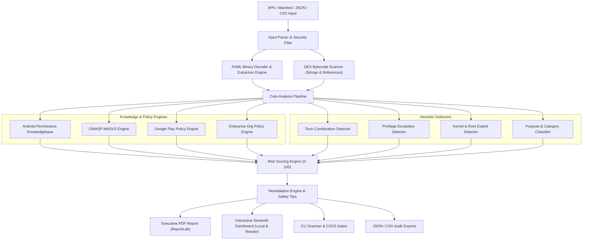

# PermGuard

<div align="center">

**Enterprise Android Permission, Security & Privacy-Risk Static Analysis Platform**

[](https://www.python.org/)
[](LICENSE)
[](tests/)
[](knowledgebase/)
[](streamlit_app.py)
[](render.yaml)
[](Dockerfile)

*Automate mobile security audits, detect overprivileged APKs, flag toxic permission combinations, and verify OWASP & Google Play compliance — in seconds.*

[Key Capabilities](#key-capabilities) • [Architecture](#architecture) • [Quickstart](#quickstart) • [CLI Scanner](#cli-scanner--cicd-gating) • [Render Deployment](#render-deployment) • [Docker](#docker-container) • [Verification](#verification)

---

</div>

## Overview

**PermGuard** is an automated, zero-execution static security analyzer for Android applications (`.apk`, `.aab`, `AndroidManifest.xml`, or permission manifests). Built for application security teams, mobile developers, and DevSecOps pipelines, PermGuard identifies privacy leaks, dangerous permission combinations, and privilege escalation vulnerabilities before apps reach production.

Traditional mobile scanners are often slow, resource-heavy, or require live device emulation. PermGuard delivers instant, transparent, mathematical risk assessments (0–100 scale) with multi-factor evidence, actionable remediation steps, audit-ready executive PDF reports, and automated CI/CD gating.

---

## Key Capabilities

- **Zero-Emulation Static Analysis**: Fast binary extraction, AXML decoding (`AndroidManifest.xml`), and Dalvik bytecode (DEX) scanning without launching suspicious code.
- **Intelligent Multi-Factor Risk Engine**: Computes a deterministic 0–100 security score based on permission breadth, protection levels, category expectations, and component attack surfaces.
- **Toxic Combination Detection**: Uncovers dangerous permission pairings that enable surveillance or exfiltration (e.g., `ACCESS_FINE_LOCATION` + `READ_CONTACTS`, or `RECORD_AUDIO` + `RECEIVE_BOOT_COMPLETED`).
- **Privilege Escalation & Root Vulnerability Scanning**: Flags exported components (services, activities, content providers), shared user IDs, cleartext HTTP traffic, root binaries, and known Linux kernel CVE patterns.
- **Regulatory & Marketplace Compliance**: Automated checks against **OWASP MASVS** (Mobile Application Security Verification Standard) and **Google Play Developer Policies**.
- **Interactive Security Dashboard**: Rich Plotly visualizations, side-by-side multi-APK comparison, SQLite scan history, and interactive policy inspector powered by Streamlit.
- **CI/CD Command-Line Interface (`cli.py`)**: Headless terminal scanner with customizable failure thresholds (`--fail-on-critical`, `--max-score`) for automated DevSecOps pipelines.
- **Executive & Compliance Reporting**: Generates branded, board-ready PDF reports (via ReportLab), machine-readable JSON security manifests, and CSV compliance audits.
- **Optional MobSF Cross-Correlation**: Ingests and correlates dynamic/static findings from existing Mobile Security Framework (MobSF) deployments.

---

## Architecture



---

## Quickstart

### Prerequisites

- **Python**: 3.10, 3.11, 3.12, or 3.13
- **Pip** or **uv**

### 1. Clone & Set Up Virtual Environment

```bash
git clone https://github.com/999arya/PermGaurd.git
cd PermGaurd

# Create virtual environment
python -m venv .venv

# Activate virtual environment
# Windows (PowerShell):
.venv\Scripts\Activate.ps1
# macOS / Linux:
source .venv/bin/activate
```

### 2. Install Dependencies

```bash
pip install -r requirements.txt
```

### 3. Launch Interactive Security Dashboard

```bash
streamlit run streamlit_app.py --server.port 8501
```

*(Alternatively, run `python app.py`)*

Open **`http://127.0.0.1:8501`** in your browser:
- Try one of the built-in synthetic test applications (**Calculator**, **Flashlight**, **Navigation**, **Voice Recorder**) to explore detection capabilities.
- Or drop in any real `.apk` (up to 250 MB) for an instant scan.

---

## CLI Scanner & CI/CD Gating

PermGuard includes a dedicated command-line interface ([`cli.py`](cli.py)) for scanning applications directly in terminal environments, pre-commit hooks, or build pipelines:

```bash
# Basic scan with terminal summary
python cli.py path/to/app.apk

# Declare app category for purpose-aware overprivilege detection
python cli.py path/to/app.apk --category calculator

# Export PDF, JSON, or CSV audit reports
python cli.py path/to/app.apk -o audit_report.pdf
python cli.py path/to/app.apk -o audit_report.json

# CI/CD Quality Gate: fail the build if risk score exceeds 50 or any CRITICAL finding is found
python cli.py path/to/app.apk --fail-on-critical --max-score 50.0
```

---

## Render Deployment

PermGuard is configured for one-click deployment to [Render](https://render.com/) via the included [`render.yaml`](render.yaml) Blueprint.

### Deploy Steps:

1. **Push your repository** to GitHub or GitLab.
2. Sign in to your **[Render Dashboard](https://dashboard.render.com/)**.
3. Click **New +** and select **Blueprint**.
4. Connect this repository. Render automatically reads `render.yaml`:
   - **Environment**: Python 3.12
   - **Build Command**: `pip install -r requirements.txt`
   - **Start Command**: `streamlit run streamlit_app.py --server.port $PORT --server.address 0.0.0.0`
   - **Health Check Path**: `/_stcore/health`
5. Click **Apply**. Render will build and deploy your live dashboard instance with persistent WebSocket support and up to 250 MB APK upload capacity.

---

## Docker Container

PermGuard includes an enterprise-ready [`Dockerfile`](Dockerfile) adhering to container security best practices (unprivileged non-root user, slim base image, automated health checks):

```bash
# Build Docker image
docker build -t permguard:latest .

# Run container
docker run -d -p 8501:8501 --name permguard permguard:latest
```

Access the dashboard at `http://localhost:8501`.

---

## Project Structure

```
├── app.py                      # Application CLI entrypoint (python app.py)
├── streamlit_app.py            # Primary interactive Streamlit dashboard
├── cli.py                      # Standalone CLI scanner with CI/CD failure gates
├── render.yaml                 # Render Blueprint specification for cloud hosting
├── Dockerfile                  # Secure container definition (non-root, health checked)
├── .dockerignore               # Container build exclusion list
├── pyproject.toml              # Modern Python packaging & tool configurations
├── requirements.txt            # Production runtime dependencies
├── requirements-local.txt      # Development dependencies (with pytest)
│
├── .github/workflows/          # Automated GitHub Actions CI workflow
│   └── ci.yml                  # Multi-version matrix test runner (Python 3.10-3.13)
│
├── config/                     # Enterprise customizable policies
│   ├── appconfig.yaml          # Upload limits, cache sizes, and scan limits
│   ├── orgpolicy.yaml          # Allowed/blocked permissions and enterprise rules
│   └── riskthresholds.yaml     # Score boundaries and severity weightings
│
├── knowledgebase/              # Security and compliance knowledge bases
│   ├── androidpermissions.json # Manifest permission risk metadata & protection levels
│   ├── appcategories.json      # Standard category permission expectations
│   ├── googleplayrules.json    # Google Play Developer Policy rules
│   ├── owasprules.json         # OWASP MASVS mobile security rules
│   └── suspiciouscombinations.json # Toxic permission combination definitions
│
├── src/                        # Core analysis and detection engines
│   ├── apkextractor.py         # ZIP stream & APK archive unpacker
│   ├── axmldecoder.py          # Binary Android XML (AXML) parser
│   ├── dexscanner.py           # Dalvik Executable (DEX) bytecode string analyzer
│   ├── combinationdetector.py  # Toxic permission combination engine
│   ├── escalationdetector.py   # Exported components & privilege escalation detector
│   ├── kernelrootdetector.py   # Root strings, su binaries & kernel CVE scanner
│   ├── manifestparser.py       # AndroidManifest.xml parser & normalizer
│   ├── permissionclassifier.py # Danger & protection-level classification
│   ├── policyengine.py         # Google Play & standard policy evaluator
│   ├── orgpolicyengine.py      # Custom enterprise policy evaluator
│   ├── owaspengine.py          # OWASP MASVS compliance verification
│   ├── purposeanalyzer.py      # Category inference & permission justification
│   ├── riskengine.py           # Transparent mathematical 0-100 risk scoring
│   ├── recommendationengine.py # Actionable remediation suggestions
│   ├── reportgenerator.py      # Executive PDF, JSON, and CSV export engine
│   ├── pipeline.py             # Orchestrated multi-stage scan pipeline
│   ├── mobsf_client.py         # Optional MobSF REST API integration client
│   ├── mobsfevidence.py        # MobSF finding correlation and evidence mapping
│   ├── security.py             # Path traversal protection & file sanitization
│   ├── storage.py              # SQLite audit persistence
│   └── scancache.py            # File hash caching layer
│
├── data/sampleapps/            # Synthetic test APKs and fixtures
├── tests/                      # Automated test suite (126 tests)
│   ├── test_cli.py             # CLI tests and CI/CD gate assertions
│   └── ...                     # Core engine, detector, and security tests
└── tools/                      # Fixture generation and maintenance utilities
```

---

## Verification & Testing

PermGuard includes an automated test suite covering all analysis pipelines, parsers, security boundaries, report generation, and CLI interfaces:

```bash
# Run complete test suite (126 tests)
pytest tests -v
```

```
============================== test session starts ==============================
collected 126 items

tests/test_cli.py ......                                                  [  4%]
tests/test_detectors.py ...................                               [ 19%]
tests/test_e2e.py .............                                           [ 30%]
tests/test_inputparsers.py ..............                                  [ 41%]
tests/test_manifestparser.py ...........                                  [ 50%]
tests/test_permissionclassifier.py ............                           [ 59%]
tests/test_policyengine.py ..............                                  [ 70%]
tests/test_reportgenerator.py ............                                 [ 80%]
tests/test_riskengine.py ..............                                    [ 91%]
tests/test_security.py ............                                       [100%]

============================== 126 passed in 1.3s ===============================
```

---

## Security & Privacy Posture

- **Zero-Persistence Processing**: Uploaded APKs and manifests are analyzed in temporary memory/disk spaces and purged immediately upon scan completion.
- **Path Traversal Protection**: All archive extracts are strictly validated against directory traversal (`../`) and Zip Bomb attacks before unpacking.
- **Zero External Telemetry**: PermGuard runs entirely air-gapped on your infrastructure. Scan data, package names, and findings are never sent to external servers.

---

## License

This project is licensed under the [MIT License](LICENSE).
